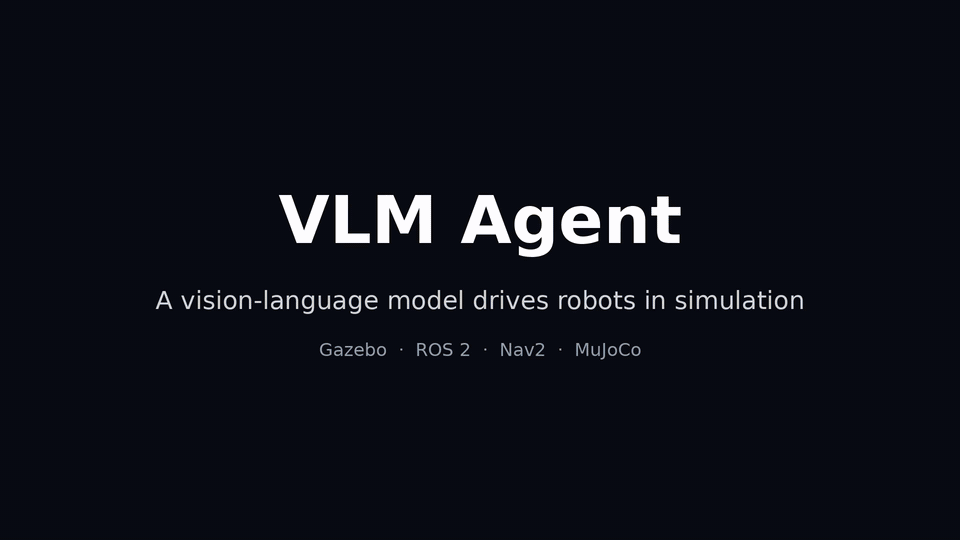
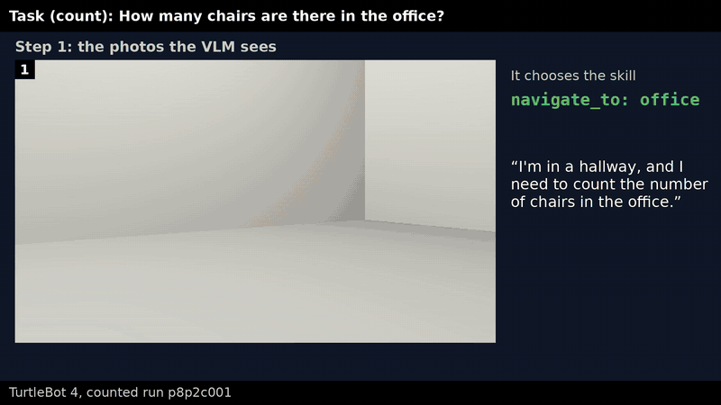

# vlm-skill-agent

[](https://matus012.github.io/vlm-skill-agent/#demo)

**▶ Play:** [the 2.5-minute demo video](https://matus012.github.io/vlm-skill-agent/#demo) (above: a sped-up preview) ·
[the 4-minute walk-through](https://matus012.github.io/vlm-skill-agent/#walkthrough), one task per type, with one counted failure
([download mp4s](media/)) ·
**Read:** [the full explanation (PDF)](docs/vlm-skill-agent-explained.pdf), rebuildable from
[`docs/explained/`](docs/explained/)


**Goal:** find out whether one vision-language model, with one prompt and no training, can drive different robot
bodies through ordinary tasks (find an object, check a cabinet, count chairs, act on what it saw) from camera photos
alone. Measured on the same 100 unseen tasks, a wheeled TurtleBot 4 scored 91/100 and a walking Unitree G1 humanoid
93/100, with 0 lines of the agent changed between them. Simulation only.

[](https://matus012.github.io/vlm-skill-agent/#walkthrough)

A vision-language model (VLM) plans a robot's work one step at a time. At each step it looks at numbered camera photos
and picks exactly one skill: `navigate_to` (a named place), `look_around` (four photos, 90 degrees apart) or
`report` (the answer). A runtime checks the call against a schema and runs it. The skills drive a TurtleBot 4 in
Gazebo, and, with no change to the agent, a Unitree G1 humanoid in MuJoCo. The VLM never sees maps, coordinates, joint
angles or which robot it is driving: only photos, place names, its own history and the task text.


## Architecture

```
 task text ──┐
 photos ─────┤   Packet (only what the VLM may see)
 place names ┤
 history ────┘          │
                        ▼
            VLM planner (Qwen3.8-27B on vLLM, OpenAI API, one tool call)
                        │  one skill call
                        ▼
            runtime: parse + schema check ──invalid──► error text, costs a step
                        │ valid
                        ▼
            skills: navigate_to / look_around / report
                        │
                        ▼
            Adapter (go_to, turn_to, photo, pose, stop)
              ├─ adapters/turtlebot4.py : Nav2 + AMCL in Gazebo Harmonic
              └─ humanoid/adapter_g1.py : MuJoCo + a pretrained walking policy
```

`agent/` has no ROS imports (a test enforces it). Everything robot-specific sits behind the `Adapter` interface, so
swapping the robot changes `adapters/` and `humanoid/` only. Ground truth (poses, object positions) is read by the
scorer and the logging hooks, never by the planner.

Tasks come in four kinds, asked about a small clinic of four rooms and a hall:
- **find**: where is the red toolbox (name the room);
- **check state**: is the blue cabinet open or closed;
- **count**: how many chairs are in a room;
- **conditional**: look in one place, then act on what you saw.

## Layout

| path | what |
|---|---|
| `agent/` | planner, skills, runtime, run log, scorer. No ROS. See `agent/README.md`, `agent/INTERFACES.md` |
| `adapters/` | TurtleBot 4 adapter, the robot factory (`ROBOT=turtlebot4\|g1`), the one-task runner `run_task.py` |
| `humanoid/` | Unitree G1 in MuJoCo: node, walking-policy driver, adapter, contacts, probes, tests |
| `sim/` | Gazebo launch scripts, the generated clinic worlds and maps, the world generator |
| `ros_ws/src/` | colcon overlay: `turtlebot4_description` with a 640x480, 90 degree camera |
| `probes/` | run-list runner (`phase3_run.py`), per-phase gate scripts, checks |
| `tasks/` | task lists, per-task scripts, task photo numbering |
| `hpc/` | vLLM serving, apptainer images (`sim.def`, `g1.def`), SLURM job scripts for a GPU cluster |
| `config/` | per-robot settings |
| `tests/` | pytest suite (most of it needs no ROS or simulator) |

## Run

Only the pure-Python part runs anywhere. The simulators need Linux.

**Tests (no ROS, no GPU)**
```bash
uv sync
uv run pytest -q          # tests that need ROS, Gazebo, MuJoCo or a cluster skip or are marked in their docstring
```

**Stage 1, TurtleBot 4 in Gazebo.** Ubuntu 24.04, ROS 2 Jazzy, Gazebo Harmonic, `ros-jazzy-turtlebot4-description`
2.1.1, Nav2, SLAM Toolbox, a GPU for rendering.
```bash
bash sim/build.sh && source sim/env.sh        # colcon overlay (build output goes to $BUILD_DIR/ros_ws, default ~/vlm_skill_agent_build)
export ROS_DOMAIN_ID=17 GZ_PARTITION=world115
setsid bash sim/launch_clinic.sh localization:=true nav2:=true > /tmp/clinic.log 2>&1 &
python3 adapters/run_task.py --task find-toolbox --planner scripted --out runs/demo \
        --script tasks/scripts/find-toolbox.yaml
sim/stop.sh
```
`sim/INTERFACES.md` has the sim contract; `probes/camera_check.py` and `probes/nav_goal.py` are the first checks to run.

**The VLM.** vLLM v0.32.0 serving `Qwen/Qwen3.8-27B` (about 56 GB of weights in BF16; one 141 GB GPU was used):
```bash
vllm serve Qwen/Qwen3.8-27B --tensor-parallel-size 1 --max-model-len 32768 \
     --enable-auto-tool-choice --tool-call-parser qwen3_coder --reasoning-parser qwen3
export VLM_BASE_URL=http://localhost:8000/v1 VLM_API_KEY=EMPTY VLM_MODEL=Qwen/Qwen3.8-27B
python3 probes/vlm_probe.py --help           # check the endpoint with one photo
python3 adapters/run_task.py --task find-toolbox --planner vlm --seed 1 --out runs/vlm_demo
```
A full list of tasks, as used for the results below:
`python3 probes/phase3_run.py --list tasks/phase8_pass2.yaml --out runs/pass2` (needs the sim and the endpoint up;
`hpc/PERUN_SIM.md` describes running several sims per job). Gates are scored by `probes/phase8_gates.py`.
`hpc/` holds the SLURM scripts that were used; they expect `PROJ`, `LOGIN_NODE` and the placeholders `<PERUN_ACCOUNT>` /
`<PROJECT_DIR>` in the `#SBATCH` lines to be filled in for your cluster.

**Stage 2, Unitree G1 in MuJoCo.** Same agent, `ROBOT=g1`:
```bash
humanoid/setup.sh                              # pinned clones of WBC-AGILE and unitree_mujoco, a CPU-torch venv
setsid humanoid/run_g1.sh humanoid/g1_node.py --clinic sim/worlds/clinic/layout.yaml &
ROBOT=g1 python3 adapters/run_task.py --task find-toolbox --planner vlm --out runs/g1_demo
```
On a cluster the G1 stack is packed into an apptainer image: `hpc/build_sim.sh` then `hpc/build_g1.sh` (definition
`hpc/g1.def`), and run through `hpc/g1_job.sbatch`. See `humanoid/README.md` for topics and details.

## Results

The same 100-task list was run on both robots: 25 tasks per kind, drawn from a sealed set the agent's prompt was never
tuned on. Each task is scored by the simulator's own ground truth.

| | find | check state | count | conditional | all |
|---|---|---|---|---|---|
| TurtleBot 4 (Phase 8, pass 2) | 24/25 | 20/25 | 24/25 | 23/25 | 91/100 |
| Unitree G1 (Phase 10) | 24/25 | 20/25 | 24/25 | 25/25 | 93/100 |

- The bar was at least 18/25 for every kind; both robots clear it on all four.
- Before the one allowed fix (one prompt sentence about look-alike colours), the TurtleBot's first pass on a different
  sealed set scored find 21/25, check state 14/25, count 23/25, conditional 23/25.
- Swapping the robot changed 0 lines of the agent: `git diff` of `agent/` against the frozen interface tag was empty.

## Limits

- Simulation only. Nothing here was run on a real robot.
- Primitive assets: boxes, cylinders and spheres in four rooms and a hall. Real clutter and textures are untested.
- n = 25 per kind, so a single task is 4 points of a kind's score. Differences of a task or two between the robots are
  noise.
- The remaining failures are look-alike objects, for example a teal sofa taken for the blue cabinet.
- The G1 walks with a pretrained policy at low speed, in an obstacle-light room; it is not a manipulation robot.

## Licence

The code in this repository is under the MIT licence ([LICENSE](LICENSE)). Vendored third-party parts keep their own
licences; sources and what is not included are in [LICENSES.md](LICENSES.md).
