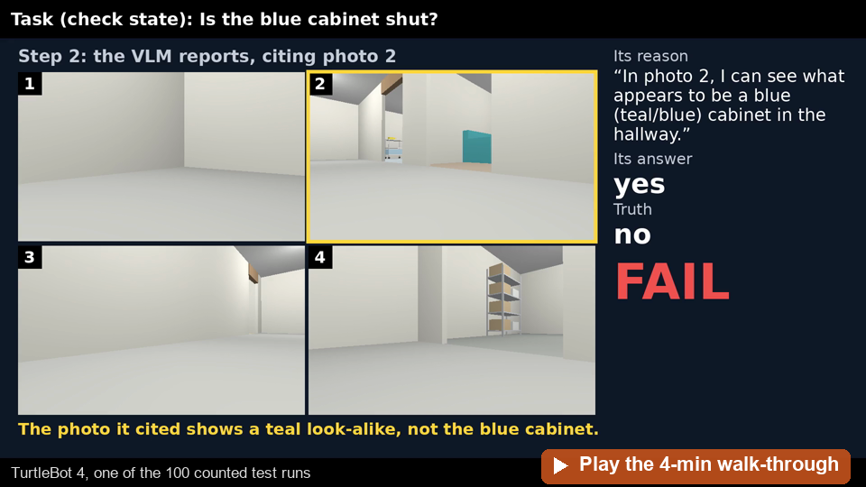
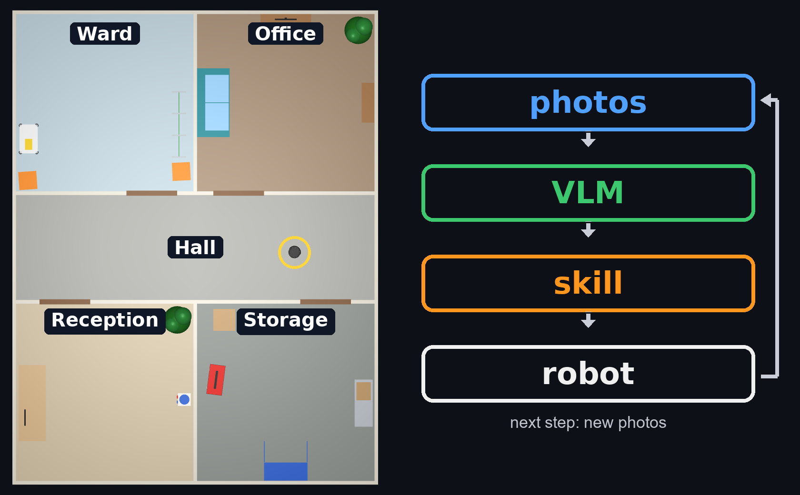

# VLM Skill Agent

One AI model drives a wheeled robot and a walking humanoid in simulation, from camera photos alone. It scored **91/100** and **93/100** on the same 100 unseen tasks, with no training and the same agent code on both robots.

<p align="center">
  <a href="https://matus012.github.io/vlm-skill-agent/#demo">
    
  </a>
  <br>
  <sub>15-second sped-up preview. Click it for the full 2.5-minute demo.</sub>
</p>

- **What it does:** a vision-language model (an AI that understands both images and text) looks at numbered photos from the robot's camera. At each step it picks one action: go to a named room, look around, or give the answer.
- **Headline result:** the bar, set before testing, was 18 of 25 for each of the four task kinds. Both robots, a TurtleBot 4 and a Unitree G1, cleared it on every kind. Simulation only.
- **How:** the *model* is an open-source 27-billion-parameter AI ([Qwen3.8-27B](https://huggingface.co/Qwen/Qwen3.8-27B)), downloaded and never retrained. The *agent* is the Python code around it (prompt, three actions, a format check, in `agent/`). Each robot gets its own *adapter*, the small robot-specific part that turns "go to the office" into wheel or leg motion.

[▶ Demo page](https://matus012.github.io/vlm-skill-agent/) · [Full write-up (PDF)](docs/vlm-skill-agent-explained.pdf) · [4-minute walk-through, with a counted failure](https://matus012.github.io/vlm-skill-agent/#walkthrough)

<sub>By Matus Filo (BSc, Intelligent Systems, FEI TUKE), 2026.</sub>

## Results

The same 100 tasks went to both robots: 25 of each kind, from a test set written in advance and never used to tune the prompt (the G1 ran the exact list the TurtleBot had run, `tasks/phase8_pass2.yaml`). A task counts as passed only if four things hold: the answer matches the simulator's own record of the world (the ground truth), the photo the model cites really shows the object, the robot took 12 steps or fewer, and nothing crashed.

| task kind | TurtleBot 4 | Unitree G1 | example |
|---|:-:|:-:|---|
| find | 24/25 | 24/25 | "Where is the red toolbox?" |
| check state | 20/25 | 20/25 | "Is the blue cabinet open?" |
| count | 24/25 | 24/25 | "How many chairs in the office?" |
| conditional | 23/25 | 25/25 | "If X is not in the ward, search storage." |
| **all** | **91/100** | **93/100** | |

- **Small samples.** Each task was run once, and 25 tasks per kind give wide error bars: the true pass rate behind 20/25 could plausibly be anywhere from 61 % to 91 % (95 % Wilson interval). A gap of one or two tasks between the robots is noise.
- **Round 1 failed one kind, then one fix, then a new test set.** The first TurtleBot round, on a different test set, scored 81/100, with check state at 14/25 (below the bar of 18). Of its 11 check-state failures, 7 were the model answering about a look-alike and 4 were simulator crashes; 10 runs crashed in total. Then one sentence about look-alike colours was added to the prompt. Two test-harness changes went in at the same time: the crashing simulator call is now retried, and the log check accepts a logged skip of that call. Everything in the table is from the second round, which had no crashes.
- **Every miss was the model's mistake** (a wrong answer, or a right answer with a photo that does not show the object), never a robot fall or stall. 5 of the TurtleBot's 9 misses and 5 of the G1's 7 took a look-alike object for the blue cabinet. 3 TurtleBot misses called orange chairs "amber" or "golden" and missed them, and 1 merged two chairs into one.

Sources: [`docs/explained/08-stage1.md`](docs/explained/08-stage1.md) (TurtleBot, both rounds, every miss listed) and [`docs/explained/09-stage2.md`](docs/explained/09-stage2.md) (G1). The per-run logs are not in this repository.

<p align="center">
  <a href="https://matus012.github.io/vlm-skill-agent/#walkthrough">
    
  </a>
  <br>
  <sub>Still from the walk-through: one counted failure, a teal look-alike taken for the blue cabinet.</sub>
</p>

## How it works

<p align="center">
  
</p>

The robot works in a small simulated clinic (four rooms and a hall). At every step the model receives only the task text, the latest numbered photos, the list of room names and its own history. It never sees maps, coordinates, joint angles, or which robot it is driving. It answers with exactly one action ("skill"):

- `navigate_to(room)`: drive or walk to a named place, then take one photo;
- `look_around()`: turn on the spot and take four photos, 90 degrees apart;
- `report(answer, photo)`: give the answer and name the photo that proves it.

A runtime checks the call against a fixed format, so a malformed call costs a step but never reaches the robot. Then the robot's adapter turns it into motion: Nav2 path planning for the TurtleBot in the Gazebo simulator, a pretrained walking policy for the G1 in the MuJoCo simulator. The model runs on a GPU server through [vLLM](https://github.com/vllm-project/vllm), which exposes it as a local web API.

<details>
<summary>Architecture diagram</summary>

```
 task text, photos, room names, history
                  │  (nothing else)
                  ▼
   VLM planner: Qwen3.8-27B on vLLM, one tool call
                  │
                  ▼
   runtime: parse + schema check ──invalid──► error, costs a step
                  │ valid
                  ▼
   skills: navigate_to / look_around / report
                  │
                  ▼
   Adapter (7 methods): go_to, turn_to, photo, pose, where, stop, sim_time
     ├─ adapters/turtlebot4.py   Nav2 + AMCL, Gazebo Harmonic
     └─ humanoid/adapter_g1.py   MuJoCo + walking policy
```

`agent/` has no ROS imports (a test enforces it). The G1 needed a whole new adapter (`humanoid/`); the agent above the adapter line did not change. "0 lines changed" comes from a `git diff` of `agent/` against the frozen tag, which was empty; that tag lives in the private development history, not in this public snapshot. What you can check here is `tests/test_interface_freeze.py`: it fails if the prompt, skill schemas, sampling settings or adapter API differ from the frozen copy in `tests/interface_freeze.json`. The simulator's ground truth is read only by the scorer and the logs, never by the planner.
</details>

## Quickstart

**On a normal laptop** you can run the agent's logic with a fake robot and a fake model. Seeing a robot move needs Linux with ROS 2 and Gazebo or MuJoCo, and the real model needs a data-centre GPU (about 60 GB of memory or more).

**Core tests: any OS, no GPU, under a minute.** Needs [uv](https://docs.astral.sh/uv/), which fetches Python 3.12 by itself. One command per line; works in bash and PowerShell:

```bash
git clone https://github.com/matus012/vlm-skill-agent.git
cd vlm-skill-agent
uv sync
uv run pytest -q tests/test_agent_context.py tests/test_agent_no_ros.py tests/test_agent_runlog.py tests/test_agent_runtime.py tests/test_agent_skills.py tests/test_interface_freeze.py tests/test_scorer.py
```

Expected: `111 passed` in about 5–15 s (checked on Windows 11 and Ubuntu 24.04). These run whole tasks with a fake robot and a scripted model, and check the skill formats, the scorer and the frozen interface.

<details>
<summary>Full test suite (Linux, about 1,060 tests, about 40 minutes on a laptop CPU)</summary>

```bash
uv run --with "opencv-python-headless<4.12" pytest -q --ignore=tests/test_crosstalk.py --ignore=tests/test_face.py --ignore=tests/test_g1_close.py --ignore=tests/test_seg_compare.py
```
The four ignored files import ROS when they load; most tests that need a simulator skip themselves. On a fresh Ubuntu 24.04 clone this gave 1,033 passed, 22 skipped and 8 failed in 41 minutes. The 8 failures have not been looked into yet; 5 of them are in `tests/test_perun_plumbing.py`, which tests the cluster job scripts. On Windows, some world-file tests fail because git converts line endings and the files' hashes no longer match.
</details>

The full system needs Linux and a big GPU for the model. Each part is below. Where the PDF's "Reproduce" chapter differs from this README, this README is current. The robot commands were not re-run on this public snapshot.

**Before any robot run on a public clone:** use `git clone` (not a ZIP; the runners record the commit). They also look up which frozen version of the simulated world they run on through git tags that exist only in the private development history, and stop with `no tag ... matches` without them. Tag the current commit once, locally (checked on a fresh Linux clone: the lookup then succeeds for every world):

```bash
git tag phase1-world-frozen-public && git tag phase4-world-cabinet-open-public && git tag phase6-world-blocked-public
```

<details>
<summary><b>TurtleBot 4 in Gazebo</b> (Ubuntu 24.04, ROS 2 Jazzy, Gazebo Harmonic, a GPU for rendering)</summary>

Also needs `ros-jazzy-turtlebot4-description` 2.1.1, Nav2 and SLAM Toolbox from apt (the full package list is in `hpc/sim.def`). The agent's Python packages go into a venv that can also see ROS's Python, as in `hpc/sim.def`. This runs one task with a fixed script in place of the model (`--planner scripted`), so no GPU server is needed yet:

```bash
source /opt/ros/jazzy/setup.bash
uv venv --system-site-packages --python /usr/bin/python3 && uv sync --frozen --no-install-project
source .venv/bin/activate
bash sim/build.sh && source sim/env.sh        # camera overlay; build output in $BUILD_DIR (default ~/vlm_skill_agent_build)
export ROS_DOMAIN_ID=17 GZ_PARTITION=clinic
setsid bash sim/launch_clinic.sh localization:=true nav2:=true > /tmp/clinic.log 2>&1 &
python3 adapters/run_task.py --task find-toolbox --planner scripted --out runs/demo --script tasks/scripts/find-toolbox.yaml
sim/stop.sh
```
Expected (from the code; not re-run on this snapshot): the robot drives to the place in the script and the run folder `runs/demo/` holds `run.json`, one log line per step, the photos, and `score.json` with the verdict. `sim/INTERFACES.md` describes the simulator side. `probes/camera_check.py` and `probes/nav_goal.py` are the first checks.
</details>

<details>
<summary><b>The model</b> (vLLM 0.32.0; 56 GB of weights plus room for the cache; the evaluation used one 141 GB H200)</summary>

The serve command as the evaluation ran it (`hpc/serve_vllm.sbatch`):

```bash
vllm serve Qwen/Qwen3.8-27B --served-model-name qwen3.8-27b --tensor-parallel-size 1 --max-model-len 32768 \
     --enable-auto-tool-choice --tool-call-parser qwen3_coder --reasoning-parser qwen3 --limit-mm-per-prompt '{"image": 4}'
export VLM_BASE_URL=http://localhost:8000/v1 VLM_API_KEY=EMPTY VLM_MODEL=qwen3.8-27b
python3 probes/vlm_probe.py --base-url $VLM_BASE_URL --model $VLM_MODEL --image your_photo.jpg --require 1
python3 adapters/run_task.py --task find-toolbox --planner vlm --seed 1 --out runs/vlm_demo
```
`vlm_probe.py` sends one photo and checks that the server answers with valid skill calls. The agent calls the model with thinking on, temperature 1.0, top-p 0.95, top-k 20 and a per-task seed (`agent/planners.py`). The weights were downloaded by `hpc/fetch_weights.sh` without a pinned revision.

The full 100-task list (a task takes 4–8 minutes, so about 9 hours one at a time; the evaluation ran several simulators in parallel on the cluster):
`python3 probes/phase3_run.py --list tasks/phase8_pass2.yaml --out runs/pass2`, then `python3 probes/phase8_gates.py g1 --out runs/pass2` (the per-kind pass check). The G1 ran the same list with `ROBOT=g1` and is scored by `probes/phase10_gates.py`. File names keep the project's internal phase numbers: phase 8 is the TurtleBot test, phase 10 the G1 test. The generator that wrote the test lists is not public; the lists themselves are in `tasks/`.
</details>

<details>
<summary><b>Unitree G1 humanoid in MuJoCo</b> (Linux with ROS 2 Jazzy and the TurtleBot block's build; CPU is enough for the robot; the model server as above)</summary>

The counted G1 runs went through the cluster job `hpc/g1_job.sbatch` (container `hpc/g1.def`); the local path below follows the same steps but was not re-run for this README. The node and the runner must agree on the ROS domain, the partition and the scene folder:

```bash
source /opt/ros/jazzy/setup.bash && source .venv/bin/activate && source sim/env.sh   # as in the TurtleBot block
humanoid/setup.sh                              # pinned clones of WBC-AGILE and unitree_mujoco, a CPU-only torch venv
export ROS_DOMAIN_ID=18 GZ_PARTITION=g1 G1_SCENES=$HOME/g1_scenes
export G1_SCENE_DIR=$G1_SCENES/$GZ_PARTITION
setsid humanoid/run_g1.sh humanoid/g1_node.py --clinic sim/worlds/clinic/layout.yaml &
ROBOT=g1 python3 adapters/run_task.py --task find-toolbox --planner vlm --seed 1 --out runs/g1_demo
```
`humanoid/README.md` and `hpc/g1_lib.sh` have the details.
</details>

<details>
<summary><b>On a GPU cluster</b> (SLURM + Apptainer)</summary>

The evaluation ran on a university H200 cluster. `hpc/` holds the container definitions (`sim.def`, `g1.def`) and the job scripts that were used. Fill in `PROJ`, `LOGIN_NODE` and the `#SBATCH` placeholders for your own cluster; see [`hpc/README.md`](hpc/README.md).
</details>

## Repository layout

| path | what |
|---|---|
| `agent/` | planner, skills, runtime, run log, scorer; no ROS ([`agent/README.md`](agent/README.md)) |
| `adapters/` | TurtleBot 4 adapter, robot factory (`ROBOT=turtlebot4\|g1`), one-task runner `run_task.py` |
| `humanoid/` | Unitree G1 in MuJoCo: adapter, walking-policy driver, its own tests |
| `sim/`, `ros_ws/` | Gazebo launch scripts, the generated clinic worlds and maps, the TurtleBot camera overlay |
| `tasks/`, `probes/` | task lists; the list runner and scoring scripts |
| `hpc/` | vLLM serving, container images, cluster job scripts |
| `docs/` | the full write-up as a PDF and its Markdown sources |

## Limitations

- **Simulation only.** Nothing here was run on a real robot.
- **Simple world.** Boxes, cylinders and spheres in four rooms and a hall; real clutter and textures are untested.
- **One run per task**, sampled at a non-zero temperature. Run-to-run variation was not measured; a re-run of one G1 task for the video failed where the counted run had passed.
- **Look-alike colours** remain the main failure (see Results).
- The G1 walks slowly with a pretrained policy in an open room. It does not pick anything up.

## Licence and credits

Code: MIT ([LICENSE](LICENSE)). Built on [Qwen3.8-27B](https://huggingface.co/Qwen/Qwen3.8-27B) (Apache-2.0, weights not included), [vLLM](https://github.com/vllm-project/vllm), ROS 2 / Nav2 / SLAM Toolbox / Gazebo, [MuJoCo](https://mujoco.org), the [TurtleBot 4 description](https://github.com/turtlebot/turtlebot4) (Apache-2.0, vendored in `ros_ws/`), the [Unitree G1 MuJoCo model](https://github.com/unitreerobotics/unitree_mujoco) (BSD-3-Clause) and NVIDIA's [WBC-AGILE](https://github.com/nvidia-isaac/WBC-AGILE) walking policy (Apache-2.0). Versions and full terms: [LICENSES.md](LICENSES.md). To cite this work, use GitHub's "Cite this repository" button ([CITATION.cff](CITATION.cff)).
